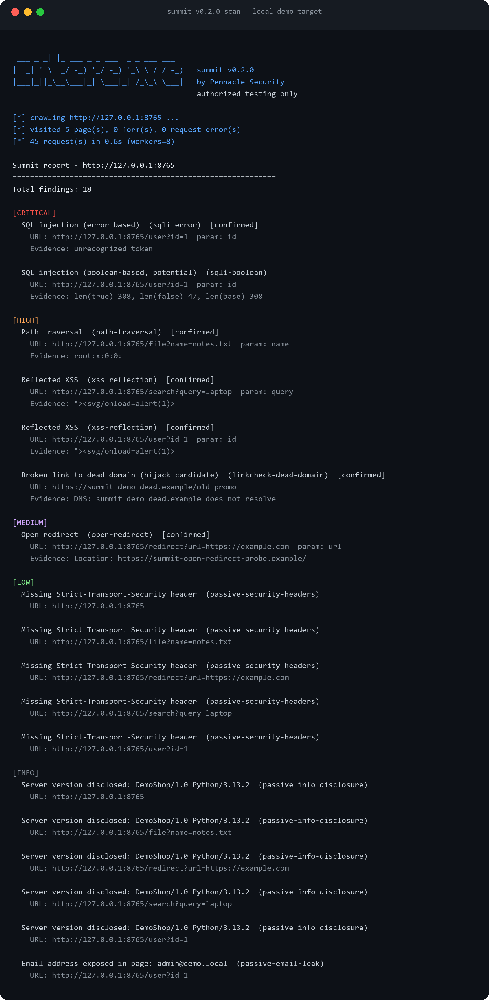

<p align="center">
  
</p>

<p align="center">
  <a href="https://github.com/pennacle-security/summit/actions/workflows/tests.yml"></a>
  <a href="https://github.com/pennacle-security/summit/releases"></a>
  
  
  
</p>

<p align="center">Proxy, scanner, fuzzer and link-hijack detection in one scriptable CLI.<br>A small, honest cousin of ZAP and Burp - by <a href="https://github.com/pennacle-security">Pennacle Security</a>.</p>

---

We use Burp and ZAP every day. We also kept wanting three things they are not: a scanner we can script against in CI, findings that tell us how sure they are, and a codebase small enough to read in one sitting. Summit is that tool. It is young (v0.2) and built in the open.

## Contents

- [Proof, not promises](#proof-not-promises)
- [Install](#install)
- [Quickstart](#quickstart)
- [Broken link hijacking](#broken-link-hijacking)
- [Anti false positives and false negatives](#anti-false-positives-and-false-negatives)
- [Check catalog](#check-catalog)
- [How summit compares](#how-summit-compares)
- [Roadmap](#roadmap)
- [Contributing and security](#contributing-and-security)
- [Legal](#legal)

## Proof, not promises

Every feature claim here is verified against [examples/vuln_app.py](examples/vuln_app.py) - a deliberately vulnerable local app with seven seeded issue classes, bound to 127.0.0.1 only. Below is a real v0.2.0 scan against it (not a mockup):

<p align="center">
  
</p>

<details>
<summary>Same output as text</summary>

```text
[*] crawling http://127.0.0.1:8765 ...
[*] visited 5 page(s), 0 form(s), 0 request error(s)
[*] 45 request(s) in 0.6s (workers=8)

Summit report - http://127.0.0.1:8765
============================================================
Total findings: 18

[CRITICAL]
  SQL injection (error-based)  (sqli-error)  [confirmed]
    URL: http://127.0.0.1:8765/user?id=1  param: id
    Evidence: unrecognized token

  SQL injection (boolean-based, potential)  (sqli-boolean)
    URL: http://127.0.0.1:8765/user?id=1  param: id
    Evidence: len(true)=308, len(false)=47, len(base)=308

[HIGH]
  Path traversal  (path-traversal)  [confirmed]
    URL: http://127.0.0.1:8765/file?name=notes.txt  param: name
    Evidence: root:x:0:0:

  Reflected XSS  (xss-reflection)  [confirmed]
    URL: http://127.0.0.1:8765/search?query=laptop  param: query
    Evidence: "><svg/onload=alert(1)>

  Reflected XSS  (xss-reflection)  [confirmed]
    URL: http://127.0.0.1:8765/user?id=1  param: id
    Evidence: "><svg/onload=alert(1)>

  Broken link to dead domain (hijack candidate)  (linkcheck-dead-domain)  [confirmed]
    URL: https://summit-demo-dead.example/old-promo
    Evidence: DNS: summit-demo-dead.example does not resolve

[MEDIUM]
  Open redirect  (open-redirect)  [confirmed]
    URL: http://127.0.0.1:8765/redirect?url=https://example.com  param: url
    Evidence: Location: https://summit-open-redirect-probe.example/

[LOW]
  ... 5x missing security headers on the crawled pages

[INFO]
  ... 5x server version disclosure
  Email address exposed in page: admin@demo.local  (passive-email-leak)
```

</details>

Run it yourself in two terminals:

    python examples/vuln_app.py             # terminal 1
    summit scan http://127.0.0.1:8765       # terminal 2

The demo also seeds a *healthy* outbound link (`https://example.com`) as a negative control - it must never be reported, and CI asserts exactly that on every push alongside the seeded detections. If a seeded issue ever stops being found, CI fails. Found something wrong anyway? [Report it](https://github.com/pennacle-security/summit/issues/new?template=bug_report.yml).

## Install

    git clone https://github.com/pennacle-security/summit.git
    cd summit
    pip install -e .

Python 3.10+. The only dependency is `requests`.

## Quickstart

    # crawl + passive + active checks + link health, console report
    summit scan https://testsite.local --depth 2 --max-pages 30 --workers 8

    # passive only - no attack traffic at all
    summit scan https://testsite.local --no-active

    # skip the outbound-link health check
    summit scan https://testsite.local --skip-linkcheck

    # write reports
    summit scan https://testsite.local --json report.json --html report.html

    # directory brute force with your own wordlist
    summit fuzz https://testsite.local -w my-wordlist.txt -e php,bak -t 20

    # local proxy, logs plain HTTP into a sqlite site map
    summit proxy --port 8080

    # repeater: send a raw request file (Burp-style)
    summit repeater examples/request.txt

## Broken link hijacking

New in v0.2. The spider records every outbound link on the target, and the engine then checks the health of each unique link:

- **dead domain** - the link's host no longer resolves. Verified with a second DNS attempt before reporting, because one flaky resolver answer should never become a hijack report. High severity, `confirmed`.
- **parked domain** - the host serves a parking page (tight fingerprints only: "this domain is parked", "buy this domain", Sedo, ParkingCrew, Bodis, HugeDomains - a page that merely mentions GoDaddy is *not* parked). Parked registrations lapse; the next owner inherits the traffic. High severity, `confirmed`.
- **broken link** - HTTP 404/410. Medium, `confirmed`.
- **unreachable** - timeouts, 5xx after one retry. Low, `potential`.
- **private-target link** - the host resolves into private/loopback/link-local space (including cloud metadata at `169.254.169.254`). Summit records it and deliberately does **not** fetch it - a hostile page cannot use your scanner as a blind SSRF probe against your own network. Info, `confirmed`.

Each unique URL is checked exactly once with a streaming GET that stops after the first few kilobytes, so a 2 GB response never gets downloaded just to learn a status code.

## Anti false positives and false negatives

False positives waste your triage time. False negatives get clients breached. Summit engineers against both instead of hoping:

| Mechanism | What it kills |
|---|---|
| **Two-stage XSS check** - a unique canary goes first; attack payloads only fire on parameters that actually reflect input | payload noise on the thousands of parameters that never reflect |
| **Baseline diffing** - every probe is compared against an unmodified request of the same parameter | error strings that were already sitting in the page before we touched it |
| **Divergence + baseline match** (boolean SQLi) - `AND 1=1` must look like the baseline, `AND 1=2` must differ, both in one direction | pages that simply vary per request |
| **Wildcard baseline in the fuzzer** - a random nonexistent path is measured first; identical answers get filtered | "everything returns 200" servers flooding your report |
| **DNS double-check** (linkcheck) - a host must fail to resolve twice before a hijack finding fires | transient resolver hiccups becoming fake "dead domain" reports |
| **SSRF guard** (linkcheck) - links resolving to private/link-local/metadata ranges are recorded, never fetched | your scanner being weaponized against internal networks |
| **Tracker/opaque param filter** - `utm_*`, `fbclid`, `gclid` and 40+ char opaque tokens are never probed | wasted requests and padded reports |
| **Scope lock** - the spider never leaves the target host (www and non-www treated as one) | crawling half the internet, and legal exposure |
| **Confidence labels** - `confirmed` means an observed fact (raw reflection, file content, a fresh DB error, a 3xx Location); `potential` means heuristic | one flat "everything is critical" triage queue |
| **Unbreakable probe hosts** - redirect probes use `.example`, which cannot resolve to any real server | third-party callbacks and accidental DoS |

Anything that fires wrong gets a `false-positive` label and a regression test. Detection quality bugs are first-class bugs here - and the CI smoke test asserts both detections *and* the negative control on every push.

## Check catalog

| Check | Type | Severity | Confirmation basis |
|---|---|---|---|
| Missing security headers (CSP, HSTS, X-Frame-Options, X-Content-Type-Options, Referrer-Policy, Permissions-Policy) | passive | low | header absence |
| Cookie flags (Secure / HttpOnly / SameSite) | passive | low-medium | header parse |
| SQL error / stack-trace disclosure (MySQL, PostgreSQL, MSSQL, SQLite, Oracle) | passive | medium | baseline-diffed signatures |
| Server and tech version disclosure | passive | info | header parse |
| CORS wildcard with credentials | passive | low | header parse |
| Email exposure | passive | info | regex |
| SQL injection, error-based | active | critical | fresh DB error vs baseline -> `confirmed` |
| SQL injection, boolean-based | active | critical | response divergence -> `potential` |
| Reflected XSS | active | high | canary + raw payload reflection -> `confirmed` |
| Open redirect | active | medium | 3xx Location to probe host -> `confirmed` |
| Path traversal | active | high | OS file indicators -> `confirmed` |
| Link to dead domain (hijack candidate) | linkcheck | high | DNS failure, verified twice -> `confirmed` |
| Link to parked domain (hijack candidate) | linkcheck | high | tight parking fingerprints -> `confirmed` |
| Broken outbound link | linkcheck | medium | HTTP 404/410 -> `confirmed` |
| Unreachable outbound link | linkcheck | low | fails after retry -> `potential` |
| Outbound link to private IP | linkcheck | info | DNS resolution -> `confirmed`, never fetched |
| Directory fuzz | fuzz | info | status + wildcard baseline |

Active checks and link health run in parallel (default 8 workers, tune with `--workers`), and every scan ends with an honest request count and wall-clock time.

## How summit compares

| | summit | ZAP | Burp Suite |
|---|---|---|---|
| Price | free, MIT | free | paid core |
| UI | CLI + HTML/JSON reports | full GUI | full GUI |
| Scriptable in CI | yes, that is the point | add-ons | paid automation |
| Findings carry confidence labels | yes | partial | partial |
| Broken link hijacking built in | yes | add-on | paid extension |
| Codebase you can audit in an afternoon | ~2k lines | large | closed source |
| TLS-intercepting proxy | on the roadmap | yes | yes |

We are not trying to replace either of them. Summit is the small tool you drop into a pipeline or onto a VPS box, and the codebase you can actually read line by line.

## Roadmap

- [ ] TLS interception in the proxy (generated CA)
- [ ] POST form and JSON body injection points
- [ ] Authenticated scanning (cookies, headers)
- [ ] SSRF and host header injection checks
- [ ] Subdomain takeover fingerprints (CNAME + service signatures)
- [ ] Plugin API for custom checks
- [ ] Request interception UI

## Contributing and security

PRs welcome - read the [contributing guide](https://github.com/pennacle-security/.github/blob/main/CONTRIBUTING.md). Adding a scan check is roughly thirty lines if you follow the pattern, and [examples/vuln_app.py](examples/vuln_app.py) gives you a live target to test against.

Security issues go through private disclosure only. Details in the [security policy](https://github.com/pennacle-security/.github/blob/main/SECURITY.md).

## Legal

Summit is built for authorized security testing: your own systems, or systems you have written permission to test. We are not responsible for misuse.

## License

MIT
